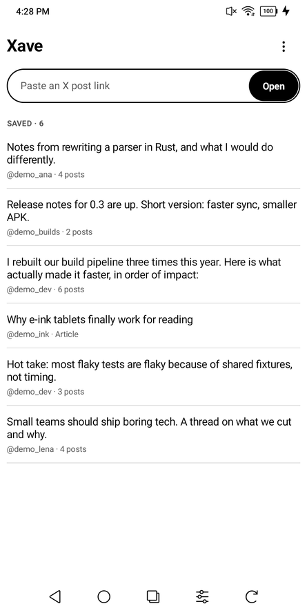
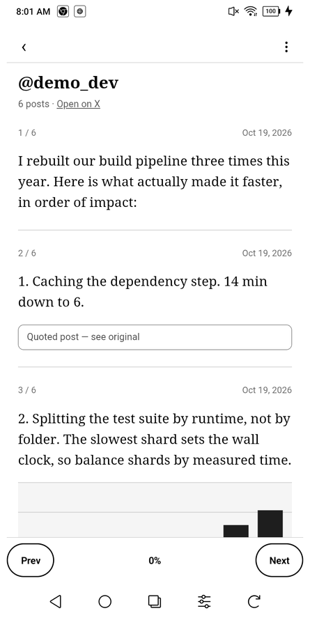
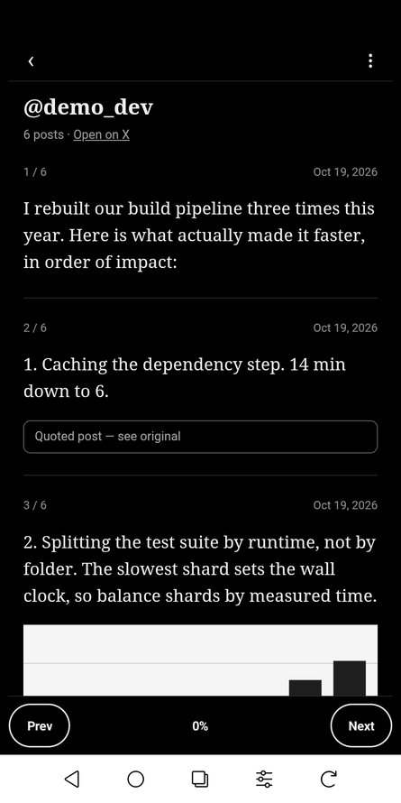

  

<h1 align="center">Xave</h1>

  
  
  

Xave is an Android app for saving X posts, threads, and Articles to read
offline. Open a post in its built-in browser, capture what it loaded, and keep a
clean, script-free copy on your device. It runs on Android 8 or later, including
phones, tablets, and e-ink devices such as the Boox Palma.

  
  
  

## Install

Download the latest APK from
[Releases](https://github.com/dkholode/xave/releases), open it on your device,
and allow installation from that source when prompted. To build it yourself,
see [android/README.md](android/README.md).

## Use

1. Paste a link to an X post or Article, or use Share in the X app and pick Xave.
2. Let the page load. A single post or an X Article saves and opens by itself.
   If the post doesn't load, or the page can't load at all, Xave tells you and
   saves nothing.
3. A thread waits for you, because only scrolling loads all of its posts. Sign
   in to X if it asks, expand long posts, scroll to load the posts you want,
   then tap **Capture**. Touching the page before it saves also lets you do
   this. Replies from other accounts aren't saved.
4. If something is missing, press Back to return to the loaded page, scroll
   further, and capture again. The new capture replaces the old one. **‹**
   returns to the library.
5. In the reader, the **⋮** menu has text size, theme, export, the post on X,
   and delete. **Prev / Next** page through it, and your position is saved.
   **Export** saves a self-contained HTML file or opens Android's
   Print / Save as PDF dialog, if a print service is installed.
6. To delete one or more items from the library, use **⋮ > Delete** there.
7. To always look over the page and tap **Capture** yourself, choose
   **⋮ > Saving** in the library, then **Review the page, then tap Capture**.

**Theme**, in the **⋮** menu, follows your system's dark mode by default. Choose
**Light** on e-ink screens for the sharpest text.

## Capture limits

- X threads contain the loaded posts by the linked post's author. Xave does not
  verify reply relationships or guarantee a complete thread. Check each capture.
- Open the full reading view before capturing an X Article. Unusual Article
  layouts may capture incompletely.
- Loaded images are saved within size and time limits. Missing images are
  marked. Video, audio, and interactive widgets are not downloaded.
- Capturing needs internet access. Saved reading blocks scripts and network
  loads. Opening a link to X takes you back online, and other links open in
  your browser.

## Privacy

Your library and X sign-in stay on your device. Xave has no account, server,
analytics, or ads, and it doesn't use cloud backup. On Android 12 and later,
Android's transfer to a new phone copies your library but not your sign-in.
Uninstalling the app or clearing its data deletes the library, so export
anything you want to keep separately.

Xave saves pages you can already open in your own browser, for your personal
reading. Respect content owners' rights and X's terms.

## Contributing

Bug reports, X capture fixes, and pull requests are welcome. See
[CONTRIBUTING.md](CONTRIBUTING.md). To report a security problem, see
[SECURITY.md](SECURITY.md).

## License

[Apache License 2.0](LICENSE)
